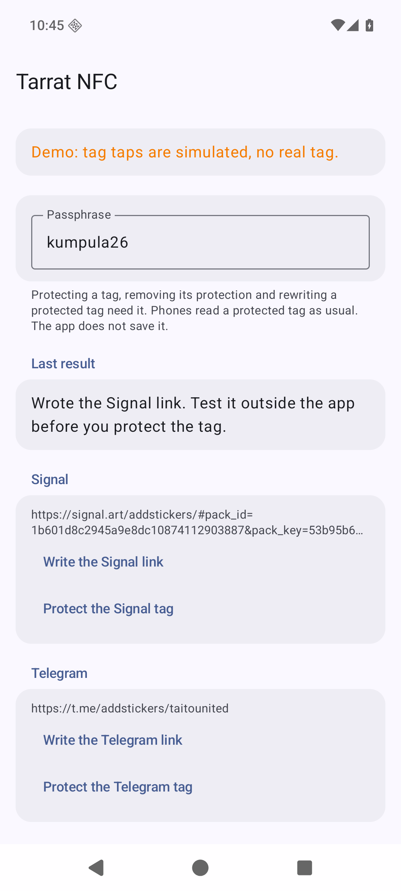
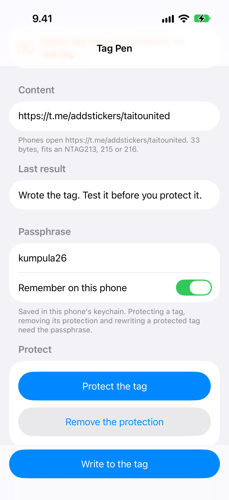

# Tag Pen

Tag Pen, in English and Finnish, where it is called NFC Kynä, is an app that writes to NFC stickers:
a link, an email address or a phone number, which a phone held on the sticker opens or offers to
call, or any other text. What you type stays on the phone, and the app shows what a phone will do
with it and how many bytes it takes. Made for the Taito United Oy stand at Kumpulan Potentiaali on
26 November 2026, where the stickers carry the Signal and Telegram sticker pack links.

You write the tag and can protect it with a passphrase so only that passphrase rewrites it; the
second button removes the protection from any tag. Phones still read a protected tag; only rewriting
it needs the passphrase. The protection is the write password of NXP's NTAG213, 215 and 216 chips,
derived from the tag's UID and the passphrase, the same on Android and iOS, so a tag protected on
one unlocks on the other.




## Parts

- `android/`: the Android app, Kotlin and Jetpack Compose, application id `app.tagpen`.
- `ios/`: the iOS app, SwiftUI with Core NFC, bundle id `app.tarrat.nfc`. Its Xcode project is
  generated from `ios/project.yml` with xcodegen.

## Tags

Use NTAG215 or NTAG216 stickers for a long link or text. An NTAG213 holds 144 bytes, enough for a
short link such as a Telegram pack but not a longer one such as the Signal pack link; the app names
the smallest tag that fits. MIFARE Classic tags do not work. A phone shows text only in an app that
reads NFC tags: an iPhone acts on its own only on links, and Android does nothing with text unless
such an app is installed.

## Try it

On an Android phone with NFC, install the debug build and open Tag Pen. Write a link, leave the
app and hold the phone on the tag to test it, then protect the tag.

An emulator has no NFC. Started with the `demo` extra, the app plays each tap on a pretend tag that
follows the same rules:

```bash
adb shell am start -n app.tagpen/.MainActivity --ez demo true
```

## Build

The Android app needs JDK 17 or newer and the Android SDK with platform 37.1 (`ANDROID_HOME`):

```bash
(cd ~/Projects/tarrat-nfc && android/gradlew -p android testDebugUnitTest assembleDebug bundleRelease)
```

The iOS app needs Xcode and xcodegen. This builds it for the simulator:

```bash
(cd ~/Projects/tarrat-nfc/ios && xcodegen generate && xcodebuild -project TagPen.xcodeproj \
  -scheme TagPen -destination 'generic/platform=iOS Simulator' -derivedDataPath build \
  CODE_SIGNING_ALLOWED=NO build)
```

In the simulator, the `-demo` launch argument plays the taps on a pretend tag.

## Start with Claude Code

```text
in ~/Projects/tarrat-nfc read CLAUDE.md, build the android and ios apps and run the unit tests, then tell me how to try them on my phone
```
